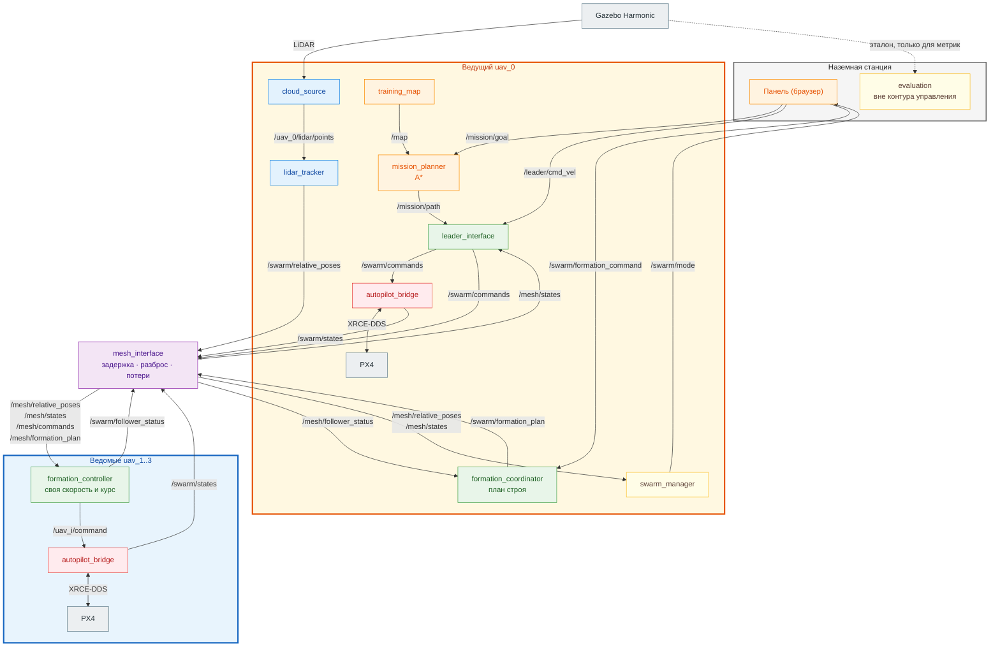

# Swarm LiDAR

Рой из четырёх квадрокоптеров PX4 в симуляции Gazebo по схеме «лидер–ведомые».
LiDAR стоит только на ведущем. По его облаку точек определяются относительные
положения трёх ведомых. Эти измерения передаются через программную mesh-сеть, и
по ним ведомые держат строй, меняют его и сопровождают лидера в ручном режиме
и в автоматической миссии.

Эталонные координаты Gazebo используются только для оценки точности. В контур
управления они не попадают: положение ведомых для удержания строя берётся
только из LiDAR.

Отчёт с архитектурой, алгоритмами и результатами финальной серии (12 полётов) —
[docs/report.md](docs/report.md).

При разработке использовался AI-ассистент (Claude): реализация кода, тестов
и документации по постановкам автора. Архитектурные решения, постановка задач
и проверка результатов — автора.

## Зависимости

Поддерживаются Ubuntu 24.04 и WSL2 с Ubuntu 24.04. Проверенные версии:

| Компонент | Версия |
|---|---|
| ROS 2 | Jazzy |
| Gazebo | Harmonic (gz-sim 8) |
| PX4 Autopilot | `878877ad022109cc4af7fea566efa0692c43813c` |
| px4_msgs | `2e892300d8c20d3c29e198e324a10854b40ab8d3` (только вместе с PX4 выше) |
| Micro XRCE-DDS Agent | `v3.0.2` |
| Python | NumPy 1.26, SciPy, Matplotlib, pymavlink 2.4.50 |

Проще всего запустить проект в Docker: образ содержит всё перечисленное.

## Запуск в Docker

Нужны Docker с Compose v2 и около 15 ГБ места. В WSL нужен ещё драйвер NVIDIA
в Windows, а в Docker Desktop — включённая WSL Integration для дистрибутива
(Settings → Resources → WSL Integration).

```bash
git clone https://github.com/Deomus/swarm_lidar && cd swarm_lidar
docker/run.sh up sim-gui    # окно Gazebo и панель
docker/run.sh up sim        # без окна
```

Готовый образ `ghcr.io/deomus/swarm-lidar` скачается сам. `run.sh` проверяет,
что система — Ubuntu 24.04, и подключает видеокарту:
- в WSL — через D3D12 (`docker/wsl.yaml`), окно через WSLg;
- на Ubuntu с NVIDIA и `nvidia-container-toolkit` — через `docker/nvidia.yaml`;
- иначе Gazebo рендерит на процессоре, примерно в 5 раз медленнее.

Выбор записывается в `.env`, поэтому дальше работает и обычный
`docker compose up sim-gui`.

Панель — `http://localhost:8080`. Записи полётов пишутся в `./log`. Остановка —
Ctrl+C: если группа в полёте, она сначала садится.

Проверка установки и сценарии в контейнере:

```bash
docker/run.sh run --rm sim python3 scripts/smoke_test.py
docker/run.sh run --rm sim python3 scripts/repeat_scenarios.py \
  --output log/series --runs 1 --scenarios s1 s2 s3 s3_pillars
```

Свой образ из исходников собирается командой `docker/run.sh build sim`.

## Сборка без Docker

1. Пакеты системы (ROS 2 Jazzy уже установлен, репозиторий Gazebo подключён):

   ```bash
   sudo apt install gz-harmonic python3-gz-transport13 python3-gz-msgs10 \
     ros-jazzy-ros-gz ros-jazzy-rosbag2-storage-mcap \
     python3-scipy python3-numpy python3-matplotlib ffmpeg
   pip3 install --break-system-packages pymavlink==2.4.50
   ```

2. PX4 SITL:

   ```bash
   git clone https://github.com/PX4/PX4-Autopilot.git ~/PX4-Autopilot
   cd ~/PX4-Autopilot && git checkout 878877ad022109cc4af7fea566efa0692c43813c
   git submodule update --init --recursive
   bash Tools/setup/ubuntu.sh --no-nuttx
   make px4_sitl
   ```

3. `px4_msgs` и агент XRCE-DDS:

   ```bash
   git clone https://github.com/PX4/px4_msgs.git ~/px4_ros_ws/src/px4_msgs
   git -C ~/px4_ros_ws/src/px4_msgs checkout 2e892300d8c20d3c29e198e324a10854b40ab8d3
   source /opt/ros/jazzy/setup.bash && cd ~/px4_ros_ws && colcon build

   git clone --depth 1 --branch v3.0.2 https://github.com/eProsima/Micro-XRCE-DDS-Agent.git /tmp/agent
   cmake -S /tmp/agent -B /tmp/agent/build && cmake --build /tmp/agent/build -j
   sudo cmake --install /tmp/agent/build && sudo ldconfig
   ```

4. Проект, из корня репозитория:

   ```bash
   source /opt/ros/jazzy/setup.bash
   source ~/px4_ros_ws/install/setup.bash
   colcon build --symlink-install
   source install/setup.bash
   ```

## Запуск

В каждом новом терминале сначала подключите окружение:

```bash
source /opt/ros/jazzy/setup.bash
source ~/px4_ros_ws/install/setup.bash
source install/setup.bash
```

Одна команда запускает Gazebo, четыре PX4, все узлы и панель управления:

```bash
ros2 launch swarm_lidar swarm_demo.launch.py
```

Панель откроется в браузере по адресу `http://127.0.0.1:8080`. В ней три
блока, по одному на каждый сценарий ТЗ:

1. **Строй и высота.** Взлёт по одному аппарату (ведущий первым). Когда
   взлетят все четыре, строй собирается сам. Дальше можно менять фигуру
   (линия, колонна, клин), масштаб и высоту роя.
2. **Ручное управление.** Кнопки пульта двигают ведущего относительно его
   курса на скорости 0,5 / 1 / 1,5 м/с. Ведомые сопровождают его сами.
3. **Маршрут к точке.** Щелчок по карте выбирает цель. Если рой на земле,
   кнопка «Взлететь и полететь» поднимает его, собирает строй и ведёт по
   маршруту A*. Если планировщик отклонил точку, причина показывается под
   картой.

Посадка — кнопка «Посадить всех». При Ctrl+C в терминале запуска панель
сначала сажает группу, затем останавливает процессы.

Основные параметры запуска (полный список — `--show-args`):

| Параметр | По умолчанию | Назначение |
|---|---|---|
| `gui` | `true` | окно Gazebo |
| `rviz` | `false` | RViz: TF, облако LiDAR, карта, маршрут, целевые места ведомых |
| `web` | `true` | панель управления |
| `video` | `false` | обзорная камера для записи видео |
| `px4_dir` | `$PX4_DIR` или `~/PX4-Autopilot` | каталог PX4 |

В WSL `sitl.py` сам включает рендер на видеокарте (D3D12, NVIDIA).

### Проверка установки и сценарии

```bash
python3 scripts/smoke_test.py      # сам запускает симуляцию, проверяет и останавливает
python3 -m pytest src scripts/test -q
```

Автоматические прогоны сценариев, каждый в новом мире, с записью rosbag и
метрик:

```bash
python3 scripts/repeat_scenarios.py --output log/series --runs 1 \
  --scenarios s1 s2 s3 s3_pillars
```

- `s1`: взлёт, высота, масштаб, линия, колонна, клин.
- `s2`: ручное сопровождение на трёх скоростях и потеря LiDAR-данных.
- `s3`: маршрут к точке.
- `s3_pillars`: маршрут к точке с обходом стены столбов.

### Метрики

Каждый прогон сохраняет в `log/<серия>/<сценарий>/flight/` журнал событий,
rosbag (MCAP), `metrics/samples.csv`, `metrics/summary.json` и графики.

Метрики по записям считают скрипты:

| Скрипт | Метрика |
|---|---|
| `analyze_scenario.py` | ошибка строя, минимальная дистанция, разбивка по скоростям и перестроениям |
| `analyze_delay.py` | задержка реакции ведомых |
| `analyze_transitions.py` | время перестроения и overshoot |
| `analyze_goal.py` | конечная ошибка миссии |
| `analyze_braking.py` | торможение при потере данных |
| `plot_mission.py` | траектории лидера и ведомых в миссии, маршрут A*, столбы |

Видео записывается так: запустить симуляцию с `video:=true`, затем
`GZ_PARTITION=swarm_lidar python3 scripts/record_video.py log/demo.mp4 --follow`.

## Архитектура



Ведущий измеряет LiDAR-ом положения ведомых и рассылает их по mesh вместе
со своим состоянием, своей командой и планом строя. Каждый ведомый сам
рассчитывает своё место и скорость и отдаёт команду своему PX4. Обратно по
mesh идут его состояние и статус. Панель управления — наземная станция; её
связь с ведущим не моделируется.

На схеме не показаны две служебные связи:
- `lidar_tracker` выравнивает облако по ориентации ведущего из его
  телеметрии `/swarm/states`, минуя mesh;
- ведущий не начинает движение, пока строй не готов: он и координатор строя
  обмениваются статусами `/mission/execution_status` и `/swarm/formation_status`.

| Пакет | Узел | Вход | Выход |
|---|---|---|---|
| `lidar_tracker` | `tracker_node` | `PointCloud2` лидара | ID, X/Y/Z, дальность, confidence, `valid` |
| `mesh_interface` | `mesh_node` | позы, состояния, команда ведущего, план и статусы строя | то же в `/mesh/*` с задержкой, разбросом и потерями |
| `swarm_manager` | `manager_node` | состояния и позы из mesh | health, режим группы |
| `formation_controller` | `coordinator_node` (ведущий) | команда строя, статусы ведомых | план строя, сводный статус |
| | `controller_node` ×3 (ведомые) | позы, состояния, команда ведущего, план строя из mesh | своя скорость и курс |
| `leader_interface` | `leader_node` | ручная скорость или маршрут | команда и траектория ведущего |
| `mission_planner` | `planner_node` | цель и карта `/map` | высота, маршрут A* |
| `autopilot_bridge` | `bridge_node` ×4, `gcs_heartbeat` | команда своего аппарата | `TrajectorySetpoint`, `VehicleCommand` PX4 |
| `evaluation` | `ground_truth_node` | эталон Gazebo и все темы | ошибки, дистанции, графики |
| `swarm_lidar` | `sitl`, `cloud_source`, `training_map`, `web_panel`, `scenario` | — | запуск, мир, карта, панель, сценарии |

Сообщения (`swarm_interfaces`):
- `RelativePose`: ID цели, время измерения, frame лидара, X/Y/Z, дальность, confidence, `valid`.
- `SwarmState`: ID, поза, скорость, курс и `yaw_rate`, режим PX4, `armed`, health, время, `valid`.
- `SwarmCommand`: ID, целевая поза и скорость (вместе с `yaw_rate`), время источника, состояние безопасности, `valid`.
- `FormationCommand`: фигура, масштаб, время перестроения, источник.
- `FormationPlan`: фигура, масштаб, включение и номер включения, начальные и конечные места ведомых, время начала и длительность перехода.

### Топики и сервисы

| Топик | Тип | Кто публикует |
|---|---|---|
| `/uav_0/lidar/points` | `PointCloud2` | `cloud_source` (облако лидара из Gazebo) |
| `/swarm/relative_poses` → `/mesh/relative_poses` | `RelativePose` | трекер → mesh |
| `/swarm/states` → `/mesh/states` | `SwarmState` | мосты PX4 → mesh |
| `/swarm/commands` → `/mesh/commands` | `SwarmCommand` | `leader_interface`: своему мосту и ведомым для упреждения |
| `/uav_i/command` | `SwarmCommand` | контроллер ведомого → его мост, локально |
| `/swarm/formation_plan` → `/mesh/formation_plan` | `FormationPlan` | координатор → ведомым |
| `/swarm/follower_status` → `/mesh/follower_status` | `String` (JSON) | ведомые → координатору |
| `/swarm/formation_command` | `FormationCommand` | панель, сценарии |
| `/swarm/formation_status`, `/swarm/target_offsets` | `String` (JSON), `PoseArray` | координатор строя |
| `/swarm/health`, `/swarm/mode` | `DiagnosticArray`, `String` | `swarm_manager` |
| `/leader/cmd_vel` | `TwistStamped` | панель (ручной режим) |
| `/mission/goal`, `/mission/path`, `/mission/plan_result` | `PoseStamped`, `Path`, `String` | панель, планировщик |
| `/mission/execution_status` | `String` (JSON) | ведущий |
| `/map` | `OccupancyGrid` | `training_map` |
| `/uav_i/fmu/in/*`, `/uav_i/fmu/out/*` | `px4_msgs` | мост ↔ PX4 |

Сервисы (`std_srvs/Trigger`):
- аппараты: `/uav_i/{arm,takeoff,land,hold,offboard,enable_stream,resume}`;
- ведущий: `/leader/{hold,manual,mission}`;
- строй: `/swarm/{enable_formation,hold}`;
- трекер: `/lidar_tracker/reset`;
- mesh: `/mesh/drop_relative_poses` — имитация потери LiDAR-поз.

## Как это работает

**LiDAR-позиционирование.** Модель лидара — 1024×256 лучей. Облако проходит
через несколько шагов:
- приводится к горизонту по ориентации лидара;
- обрезается по дальности и полосе высот 1,0–2,9 м ниже датчика;
- из него удаляется грунт.

Оставшиеся точки собираются в кластеры евклидовой кластеризацией через
KD-дерево. Слишком большие кластеры (столбы, стены) отбрасываются. Центр
каждого кластера сопоставляется с прогнозом трека ведомого: последняя позиция
плюс скорость, умноженная на время. Неоднозначное сопоставление не
используется: лучше потерять цель на кадр, чем перепутать номера. Номера
привязаны к известным стартовым местам. После потери цель повторно
захватывается у последнего положения.

**Управление строем.** Место ведомого — `P_i = P_leader + R(yaw)·offset_i`.
Набор `offset_i` задают фигура (линия, колонна, клин) и масштаб. Каждый
ведомый считает только свою команду, своим экземпляром `formation_controller`.
Скорость ведомого складывается из:
- упреждения по заданной команде ведущего из mesh;
- P-поправки по ошибке LiDAR (по высоте — PD);
- поправки на вращение строя.

Поправка сглаживается двумя скользящими средними. Итог ограничен по
скорости (2 м/с), ускорению (4 м/с²) и рывку (8 м/с³). Ведомые держат курс
лидера.

Назначение мест требует согласия всей группы, поэтому его делает
`formation_coordinator` на ведущем. При смене фигуры он перебирает все
назначения ведомых на новые места и выбирает безопасное назначение с
наименьшим путём; минимальная дистанция на прямых путях считается
аналитически. Ведомым рассылается план: начальные и конечные места, время
начала и длительность. Переход идёт по сглаженному шагу `s = u²(3 − 2u)`.
Каждый ведомый сам вычисляет точку перехода на текущий момент по общим часам,
поэтому задержка mesh не сдвигает места ведомых друг относительно друга.
Если ведомый выбыл, координатор замораживает переход для всех.

**Безопасность.**
- **Минимальная дистанция.** Минимум 2 м проверяется до перестроения. В
  полёте при сближении меньше 3 м работает отталкивание. Каждый ведомый
  видит позы всех аппаратов и при нарушении минимума любой парой сам
  останавливается (`COLLISION_STOP`), не дожидаясь ведущего; координатор
  затем выключает строй для всех.
- **Устаревшие данные.** Если позы LiDAR или план строя старше 0,5 с,
  ведомый тормозит и удерживает место (`DATA_HOLD`). Остальные продолжают
  держать строй. Если отказ длится 5 с, мост переводит PX4
  в Loiter; если 30 с — сажает аппарат. Вернуть аппарат можно сервисом
  `resume` или кнопкой панели.
- **Отказы на уровне группы.** Режимы роя (`FORMING`, `FOLLOWING`,
  `DEGRADED`, `FAILSAFE` и др.) публикует `swarm_manager`. Ведомый,
  севший по команде, переводит группу в `DEGRADED`.

**Маршрут и автопилот.** Планировщик выбирает высоту: запрошенную или рабочую
(3 м), но не ниже безопасных 2 м. Ниже грунт попадает в полосу поиска
LiDAR. Затем A* ищет путь по сетке 1 м (8 направлений, без срезания углов).
Препятствия раздуты на радиус строя плюс запас 0,75 м. Путь сглаживается
по прямой видимости. Ведущий поворачивается к текущей точке маршрута и ведёт
строй; в конце группа переходит в HOLD.

Мост переводит ENU/FLU ROS в NED/FRD PX4. Он шлёт PX4 `OffboardControlMode` и
`TrajectorySetpoint` (скорость и `yaw_rate`) через XRCE-DDS. Команда
принимается, только если она свежая и действительная, иначе мост шлёт нулевую
скорость.

**Mesh.** Канал с очередью ограниченной ёмкости. Он может добавлять
задержку, случайный разброс и потерю пакетов с фиксированным seed. Исходные
отметки времени сохраняются, поэтому старое измерение нельзя принять за новое.
Сервис `/mesh/drop_relative_poses` имитирует кратковременную потерю поз всех
целей или одного ведомого.

## Допущения

- Аппаратов ровно четыре: ведущий и три ведомых. Стартовые места известны
  (`config/swarm.yaml`), по ним трекер присваивает номера.
- Центр кластера LiDAR — центр видимой поверхности аппарата, без ориентации.
- Карта площадки статическая и двумерная (`config/obstacles.yaml`).
  Препятствия считаются бесконечно высокими. Карта задана заранее и не
  строится по LiDAR.
- Mesh — программная модель канала, физический уровень не моделируется.
- Курс и высоту ведущего ведомые получают из его телеметрии PX4 через mesh.
  Положения ведомых относительно лидера — только из LiDAR.

## Известные ограничения и что не сделано

- Ведомый, севший не на своё стартовое место, после повторного взлёта не
  возвращается в строй: трекер ищет его у последнего известного положения.
  *Как сделать:* подсказка трекеру по позиции PX4 при повторном захвате.
- Маршрут миссии строится после взлёта и сбора строя: планировщику нужна
  позиция ведущего в воздухе.
- Треки ведомых сглаживает α-фильтр с прогнозом по постоянной скорости и
  постоянным весом измерения α = 0,7. Фильтра Калмана с весом по оценке
  неопределённости нет.
- Автоматического выбора формации по условиям движения нет.
- Docker на Ubuntu с NVIDIA (`docker/nvidia.yaml`) не проверялся: такой
  машины не было.

## Сторонние компоненты

Используются без изменений:
- PX4 Autopilot и `px4_msgs`;
- Micro XRCE-DDS Agent;
- Gazebo Harmonic, ROS 2 Jazzy и `ros_gz`;
- модель квадрокоптера x500 из PX4;
- NumPy, SciPy, Matplotlib и pymavlink.

Код пакетов `src/` и скрипты написаны в рамках проекта.
