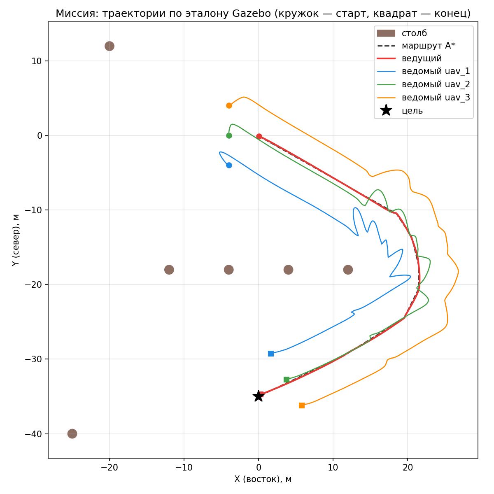
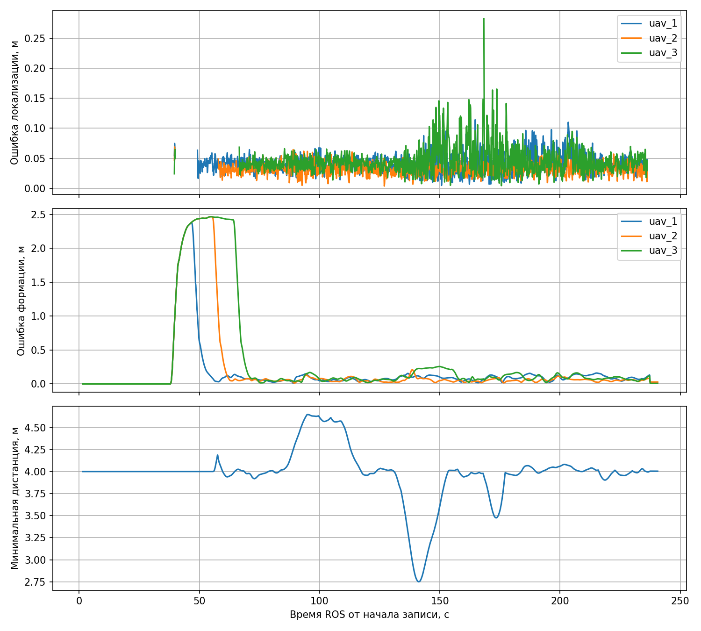

# Отчёт: роевое управление БПЛА на основе LiDAR ведущего

Симуляция: ROS 2 Jazzy, Gazebo Harmonic, PX4 SITL. Рой из четырёх x500:
ведущий `uav_0` с LiDAR и три ведомых `uav_1..3`. Установка и запуск описаны
в [README](../README.md), там же схема архитектуры и полный список топиков.

## 1. Архитектура и ROS 2 интерфейсы

Узлы распределены по аппаратам, как в разделе 3 ТЗ. Обмениваются они только
через `mesh_interface`, который может вносить задержку, разброс и потери.

- **Ведущий.**
  - `lidar_tracker` определяет относительные позы ведомых по облаку;
  - `leader_interface` ведёт ведущего по ручной команде или маршруту;
  - `mission_planner` строит маршрут A*;
  - `formation_coordinator` рассылает план строя;
  - `swarm_manager` выдаёт режим группы и health;
  - `autopilot_bridge` и PX4.
- **Каждый ведомый.** Свой `formation_controller` и свой `autopilot_bridge` с PX4.
- **Наземная станция.** Браузерная панель и `evaluation`. Узел `evaluation`
  читает эталон Gazebo и в управление не входит.

| От кого → кому | Что передаётся по mesh |
|---|---|
| ведущий → ведомые | `RelativePose` (ID, X/Y/Z в системе лидара, дальность, confidence, время измерения, `valid`), состояния `SwarmState`, команда ведущего `SwarmCommand`, план строя `FormationPlan` |
| ведомые → ведущий | их `SwarmState` и статус строя (режим, ошибка места, минимальная дистанция) |

Команду своему PX4 каждый аппарат отдаёт локально. Мост переводит её в
`TrajectorySetpoint` (скорость и `yaw_rate`) и `VehicleCommand` через
XRCE-DDS, с переходом от ENU/FLU к NED/FRD.

## 2. LiDAR-позиционирование ведомых

LiDAR ведущего (1024×256 лучей) даёт облако `PointCloud2`. Обработка облака:

1. Облако приводится к горизонту по ориентации ведущего на время скана.
2. Остаётся полоса высот 1,0–2,9 м ниже датчика, где летят ведомые. Грунт удаляется.
3. Евклидова кластеризация через KD-дерево (радиус 0,5 м). Кластеры крупнее
   1,5 м (столбы, стены) отбрасываются.
4. Центр кластера сопоставляется с прогнозом трека ведомого: позиция плюс
   скорость, умноженная на время. Ворота 2 м. Неоднозначные сопоставления
   отбрасываются: лучше потерять цель на кадр, чем перепутать номера.
5. Трек сглаживается α-фильтром (α = 0,7) с моделью постоянной скорости.

Номера ведомых привязаны к известным стартовым местам. После потери цель
повторно захватывается у последнего положения. Позиции ведомых для
удержания строя берутся только отсюда; эталон Gazebo нужен только для
оценки точности.

## 3. Управление строем и безопасность

Место ведомого: `P_i = P_leader + R(yaw)·offset_i`. Набор `offset_i` задают
фигура (линия, колонна, клин) и масштаб. Каждый ведомый считает свою
скорость сам. Она складывается из трёх частей:
- **упреждение:** заданная команда ведущего из mesh;
- **поправка по ошибке LiDAR:** P по горизонтали (0,3), PD по высоте (0,6 / 0,6);
- **поправка на вращение строя.**

Поправка сглаживается двумя скользящими средними. Итоговая команда ограничена:
2 м/с по скорости, 4 м/с² по ускорению, 8 м/с³ по рывку. Ведомые держат курс
ведущего.

Перестроение согласует координатор на ведущем. Он перебирает все назначения
ведомых на новые места и выбирает безопасное с наименьшим путём: минимальная
дистанция на прямых путях считается аналитически. Ведомым рассылается план
перехода по сглаженному шагу `s = u²(3 − 2u)`. Каждый ведомый вычисляет
точку перехода по общим часам, поэтому задержка mesh не сдвигает ведомых
относительно друг друга.

**Безопасность.**
- **Минимальная дистанция.** Минимум 2 м проверяется до перестроения. При
  сближении меньше 3 м работает отталкивание. Если любая пара ближе 2,2 м,
  каждый ведомый сам останавливается (`COLLISION_STOP`) до нового включения
  строя.
- **Устаревшие данные.** Если позы LiDAR или план старше 0,5 с, ведомый
  тормозит и держит место (`DATA_HOLD`), остальные продолжают. Если отказ
  длится 5 с, мост переводит PX4 в Loiter; если 30 с — сажает аппарат.
- **Режим группы.** `swarm_manager` публикует `FOLLOWING`, `DEGRADED`,
  `FAILSAFE` и др.

## 4. Планирование маршрута и интеграция с автопилотом

Высота маршрута — запрошенная или рабочая (3 м), но не ниже 2 м: ниже грунт
попадает в полосу поиска ведомых LiDAR-ом. A* ищет путь по сетке 1 м в
8 направлениях, без срезания углов. Препятствия раздуты на радиус строя
(6 м) и запас 0,75 м, путь сглаживается по прямой видимости.

Ведущий поворачивается к текущей точке маршрута и ведёт строй. Движение
начинается только при готовом строе. В конце группа переходит в HOLD.

Если цель выбрана на карте, пока рой на земле, панель сама выполняет весь
сценарий: взлёт по очереди, сбор строя, маршрут.

## 5. Результаты

**Серия.** 12 полётов, по 3 на каждый сценарий, каждый в новом мире Gazebo.
Все пройдены с подтверждённой посадкой. Код всех прогонов один и тот же,
коммит `ae91896`; часть прогонов записана с отметкой `cfcffc3`, где изменён
только README.

Метрики считаются по rosbag (MCAP) относительно эталона Gazebo за время
работы контура строя. Ниже указан разброс между тремя прогонами каждого
сценария.

- **S1:** взлёт по одному, высота ±, масштаб ×1,15 и обратно, линия → колонна → клин → линия.
- **S2:** ручное ведение на 0,5 / 1 / 1,5 м/с с поворотами, разгоном и высотой, затем потеря LiDAR-поз в mesh на 0,7 с.
- **S3:** маршрут к точке (6; 3).
- **S3 со столбами:** маршрут к точке (0; −35) за стеной столбов.

| Метрика ТЗ | S1 | S2 | S3 | S3 со столбами |
|---|---|---|---|---|
| Ошибка строя: среднее, м | 0,077–0,079 | 0,142–0,155 | 0,203–0,233 | 0,144–0,219 |
| Ошибка строя: RMS, м | 0,089–0,092 | 0,172–0,185 | 0,271–0,297 | 0,199–0,297 |
| Ошибка строя: максимум, м | 0,25–0,33 | 0,44–0,54 | 0,70–0,75 | 0,78–0,97 |
| Минимальная дистанция, м (порог 2,2) | 2,74 | 3,90 | 3,94 | 3,78 |
| Ошибка LiDAR-позиции, RMS, м | 0,043–0,045 | 0,039 | 0,038 | 0,038–0,039 |

**Следование за лидером.** Скорость ведомых отстаёт от скорости ведущего на
0–0,1 с: это сдвиг максимума взаимной корреляции скоростей по оси X в S2,
корреляция 0,93–0,998. Отставание малое, потому что ведомые берут заданную
команду ведущего как упреждение.

**Перестроение (S1).** Ведомые приходят на новые места к концу заданного
времени перехода: остаток после него меньше 0,02 с при полосе установления
0,3 м. Столкновений нет, минимальная дистанция 2,74 м.

| Переход | Время, с | Максимальный overshoot, м | RMS отставания от движущегося места, м |
|---|---|---|---|
| линия ×1 → ×1,15 | 12 | 0,10–0,14 | 0,08–0,09 |
| ×1,15 → ×1 | 12 | 0,03–0,07 | 0,06–0,07 |
| линия → колонна | 25 | 0,21 | 0,17 |
| колонна → клин | 25 | 0,08–0,13 | 0,10–0,11 |
| клин → линия | 20 | 0,09–0,16 | 0,10–0,12 |

**Ручной режим (S2), ошибка строя по скоростям ведущего:**

| Скорость | Среднее, м | RMS, м | Максимум, м |
|---|---|---|---|
| 0,5 м/с | 0,14–0,16 | 0,17–0,20 | 0,43–0,54 |
| 1,0 м/с | 0,14–0,16 | 0,17–0,18 | 0,42–0,44 |
| 1,5 м/с | 0,15–0,16 | 0,18–0,19 | 0,43–0,47 |

Ошибка почти не растёт со скоростью: упреждение по команде ведущего убирает
отставание. Остаток в основном приходится на повороты и изменение высоты.

**Потеря данных (S2).** После прекращения передачи поз ведомые переходят в
`DATA_HOLD` с нулевыми командами через 0,48–0,52 с (порог свежести 0,5 с).
После восстановления передачи строй возвращается к удержанию через
1,8–1,9 с от начала потери (сама потеря длится 0,7 с).

**Миссия.**

| Показатель | S3 | S3 со столбами |
|---|---|---|
| Отклонение ведущего от маршрута: среднее / максимум, м | 0,19–0,21 / 0,29–0,44 | 0,14–0,21 / 0,26–0,32 |
| Ошибка строя на маршруте, RMS, м | 0,29–0,32 | 0,20–0,30 |
| Конечная ошибка ведущего у цели, м | 0,20–0,48 | 0,28–0,40 |

Маршрут со столбами обходит стену по краю с запасом под весь строй.

На поворотах маршрута ведомые идут волнами, сильнее всего внешний `uav_1`.
Ведущий на каждой вершине пути доворачивает курс, а строй жёсткий и
вращается вместе с ним, поэтому места в 4 м от ведущего движутся по дугам.
Отсюда максимумы ошибки строя в S3 (0,7–0,97 м).

Всплеск ошибки строя в начале графика S1 — взлёт до включения контура
строя; в метрики он не входит.

## 6. Ограничения и возможные улучшения

**Ограничения.**
- Номера ведомых привязаны к стартовым местам. Ведомый, севший не на своё
  место, после повторного взлёта в строй не возвращается.
- Карта статическая и двумерная: препятствия заданы заранее и считаются
  бесконечно высокими.
- Маршрут строится после сбора строя в воздухе.
- В симуляции все узлы работают на одном компьютере; разнесение по
  аппаратам логическое, через mesh.

**Возможные улучшения.**
1. **Курс ведущего на точку впереди по маршруту** вместо ближайшей вершины.
   Повороты станут плавнее, волны крайних ведомых уменьшатся.
2. **Фильтр Калмана вместо α-фильтра** и ворота сопоставления по расстоянию
   Махаланобиса. Надёжнее после пропусков и на быстрых манёврах.
3. **Повторный захват ведомого с подсказкой его позиции PX4** — возврат в строй
   после посадки в другом месте.
4. **Выбор формы строя по ширине прохода.** Например, перестроение в колонну
   перед узким местом.
